<!-- header:start -->
<div align="center">



<a href="#-quick-start"></a>

<a href="LICENSE"></a>

<a href="https://github.com/ajendras/sheild-aj/stargazers"></a>
<a href="https://github.com/ajendras/sheild-aj/actions/workflows/ci.yml"></a>

<a href="CONTRIBUTING.md"></a>

**Automates bulletproof webhook security for PHP with signature validation, replay prevention, rate limiting and threat detection**

[✨ Features](#-features) • [⚡ Quick start](#-quick-start) • [🧰 Usage](#-usage) • [🧩 Architecture](#-architecture) • [📍 Roadmap](#-roadmap) • [🤝 Contributing](#-contributing)

</div>
<!-- header:end -->

## ✨ Why Hook Shield?

Payment gateways and SaaS platforms rely on webhooks for critical state changes, yet most PHP implementations get signature checks, replay protection or rate limits wrong. The rising UPI gateways highlight the need for a reusable, framework-agnostic security layer. Hook Shield gives developers a single, auditable shield so they can focus on business logic instead of reinventing crypto.

- **Defense-in-depth by default** — constant-time HMAC-SHA256 (and RSA-PSS/Ed25519), nonce+timestamp replay blocking, and sliding-window rate limiting
- **Zero-trust threat detection** — configurable rules for payload size, IP blocklists, schema validation and custom callables
- **Framework agnostic** — PSR-7/PSR-15 middleware plus Laravel service-provider and Symfony bundle adapters
- **Built-in testing** — `Shield::test()` and the `hookshield test` CLI simulate legitimate and malicious payloads

## 🎬 Demo

<p align="center"></p>

## 🚀 Features

<table>
<tr>
<td>
🔐 <b>Signature Validation</b><br>
Constant-time HMAC-SHA256, RSA-PSS verification with pluggable validators
</td>
<td>
🛡️ <b>Replay Protection</b><br>
Timestamp + nonce checks backed by PSR-6 cache
</td>
<td>
📏 <b>Rate Limiting</b><br>
Per-origin sliding-window limits using any PSR-6 adapter
</td>
</tr>
<tr>
<td>
🚨 <b>Threat Detector</b><br>
Configurable rules for size, IP blocklist, schema and custom logic
</td>
<td>
📨 <b>Event Router</b><br>
Maps validated events to callables or framework listeners with wildcards
</td>
<td>
📋 <b>Audit Logging</b><br>
Structured, redacted PSR-3 logs of every attempt
</td>
</tr>
<tr>
<td>
🧪 <b>Test CLI</b><br>
`hookshield test` simulates legitimate and malicious webhooks
</td>
<td>
🔌 <b>PSR-15 Middleware</b><br>
Drop-in protection with automatic 403 responses
</td>
<td>
🧩 <b>Framework Adapters</b><br>
Laravel controller and Symfony bundle ready
</td>
</tr>
</table>

## 📦 Installation

Requires **PHP 8.2+** and the suggested packages for full functionality.

```bash
composer require hook-shield/hook-shield

# For the test CLI
composer require --dev symfony/console

# For the plain-PHP example
composer require nyholm/psr7
```

Run the example server:

```bash
php -S localhost:8080 -t examples/plain-php
```

Run the test suite:

```bash
vendor/bin/phpunit --testsuite=unit,feature
```

The binary `bin/hookshield` is automatically installed and provides the `test` command.

## ⚡ Quick start

```php
<?php

use HookShield\Shield;
use GuzzleHttp\Psr7\ServerRequest;

$request = new ServerRequest(
    'POST',
    '/webhooks',
    [
        'X-Signature' => 'expected-signature-here',
        'X-Timestamp' => (string) time(),
        'X-Nonce'     => 'unique-nonce-123',
    ],
    '{"event":"upi.payment.succeeded","amount":1000}'
);

$config = [
    'secret' => 'your-webhook-secret-123',
    'validator' => 'hmac-sha256',
    'cache' => new \Symfony\Component\Cache\Adapter\ArrayAdapter(),
];

$result = Shield::protect($request, $config);

if ($result->isSuccessful()) {
    echo "Event: {$result->event}\n";
    // process $result->payload
} else {
    http_response_code(403);
    echo json_encode(['error' => $result->violations[0]]);
}
```

## 🧰 Usage

### Testing locally with the built-in helper

```php
use HookShield\Shield;

$result = Shield::test(
    'upi.payment.succeeded',
    ['amount' => 1500, 'currency' => 'INR'],
    'test-secret-123'
);

echo $result->isSuccessful() ? 'Accepted' : 'Rejected';
```

### Using the EventRouter with wildcards

```php
use HookShield\Router\EventRouter;

$router = new EventRouter();

$router
    ->register('upi.*', function (string $event, array $payload): void {
        // handle UPI events (higher priority)
        logger()->info('UPI event', ['transaction_id' => $payload['transaction_id'] ?? null]);
    }, 100)
    ->register('*', function (string $event, array $payload): void {
        // fallback
    }, -100);

// Pass to config
$config = ['secret' => '...', 'router' => $router];
```

### PSR-15 middleware in any framework

```php
use HookShield\Middleware\ShieldMiddleware;
use Psr\Http\Message\ServerRequestInterface;

$middleware = new ShieldMiddleware([
    'secret' => 'your-secret',
    'cache'  => $cache,
    'rules'  => [
        \HookShield\Threat\ThreatDetector::payloadSizeRule(32768),
        \HookShield\Threat\ThreatDetector::requiredFieldsRule(['event', 'transaction_id']),
    ],
]);

// In your request pipeline:
$response = $middleware->process($request, $handler);
```

<details><summary>Advanced: Custom threat rule + CLI test command</summary>

```php
use HookShield\Threat\ThreatDetector;

// Add a custom rule
$detector = new ThreatDetector();
$detector->addRule(function (array $payload, array $meta): ?string {
    if (isset($payload['amount']) && $payload['amount'] < 0) {
        return 'Negative amount not allowed';
    }
    return null;
});

// Run via CLI (also supports --malicious)
php bin/hookshield test \
  --event=upi.payment.succeeded \
  --payload='{"amount":1000}' \
  --secret=your-secret-123
```

</details>

## 🔧 Configuration

| Option | Default | Description |
|--------|---------|-------------|
| `secret` | `''` | HMAC secret (or public key for RSA); required |
| `validator` | `'hmac-sha256'` | Signature scheme (`hmac-sha256`, `rsa-pss`) |
| `tolerance` | `300` | Replay timestamp window in seconds (≥30) |
| `rate_limit` | `['max' => 100, 'window' => 60]` | Sliding window limit per origin |
| `cache` | `ArrayAdapter()` | Any PSR-6 `CacheItemPoolInterface` |
| `rules` | `[]` | Array of callables or `ThreatDetector` rules |
| `signature.header` | `'x-signature'` | Header name containing the signature |
| `signature.prefix` | `''` | Optional prefix to strip (e.g. `sha256=`) |
| `logger` | `null` | PSR-3 logger for structured audit logs |
| `router` | `null` | `EventRouter` instance for automatic dispatch |

All values are validated by `HookShield\Config\Configuration::validate()`.

## 🧩 Architecture

```mermaid
flowchart TD
    Request[PSR-7 ServerRequest] --> Shield[Shield::protect]
    Shield --> Config[Configuration::validate]
    Config --> Validator[SignatureValidator<br/>(HmacSha256Validator / RsaPssValidator)]
    Shield --> Replay[ReplayProtector<br/>(nonce + timestamp via Cache)]
    Shield --> Limiter[RateLimiter<br/>(sliding window via Cache)]
    Shield --> Detector[ThreatDetector<br/>(payloadSizeRule, ipBlocklistRule, ...)]
    Shield --> Router[EventRouter<br/>(register / dispatch)]
    Validator --> Result[Result VO]
    Replay --> Result
    Limiter --> Result
    Detector --> Result
    Router --> Result
    Result --> Middleware[ShieldMiddleware<br/>(403 on failure)]
    Result --> Logger[PSR-3 Logger]
```

Hook Shield follows a strict linear pipeline that short-circuits on the first failure. Every component (`ReplayProtector`, `RateLimiter`, `ThreatDetector`, etc.) can be used independently. The `Shield` facade and `Configuration` class guarantee safe defaults and constant-time operations.

## 📁 Project structure

```text
src/
├── HookShield.php                 # Shield facade + Result value object
├── Config/
│   └── Configuration.php          # load() + validate() with strict defaults
├── Validator/
│   └── SignatureValidator.php     # interface + HmacSha256Validator, RsaPssValidator
├── Protector/
│   └── ReplayProtector.php        # nonce + timestamp replay checks
├── RateLimiter.php                # sliding-window rate limiting
├── Router/
│   └── EventRouter.php            # wildcard registration and dispatch
├── Threat/
│   └── ThreatDetector.php         # rule engine with static factories
├── Middleware/
│   └── ShieldMiddleware.php       # PSR-15 middleware, attaches result attributes
└── CLI/
    └── TestCommand.php            # Symfony Console command (bin/hookshield test)

tests/
├── Unit/SignatureValidatorTest.php   # timing-safe HMAC & RSA tests
└── Feature/EndToEndTest.php          # full pipeline: valid, replay, rate-limit, threat

examples/
├── plain-php/index.php            # runnable demo with Nyholm PSR-7
└── laravel/WebhookController.php  # Laravel integration example
```

## 🧪 Testing

```bash
vendor/bin/phpunit --testsuite=unit,feature
```

The suite covers:
- Unit tests for all signature validators (including timing-attack resistance)
- Feature tests exercising the complete pipeline (`Shield::protect`) — valid webhooks, replay blocking, rate limiting, threat detection, and middleware responses

## 📍 Roadmap

<!-- roadmap:start -->
- [x] **v0.1.0** — first release: Signature Validation, Replay Protection, Rate Limiting, Event Router
- [ ] Add Stripe and Razorpay preset signature schemes
- [ ] Redis + APCu cache adapters for high-throughput nonce storage
- [ ] Symfony bundle and auto-registration of middleware
- [ ] WordPress plugin with admin UI for secret management
- [ ] UPI-specific payload schema validator rules
- [ ] Exportable audit log to OpenTelemetry traces
- [ ] GitHub Action that scans webhook routes for missing ShieldMiddleware
- [ ] Simple statistical anomaly detector using recent payload stats
- [ ] Webhook retry queue with exponential backoff helper
- [ ] Zero-downtime secret rotation helper command
- [ ] Official Laravel 12 and Symfony 7 test coverage badges
- [ ] Interactive config wizard via CLI

> 🤖 This roadmap is worked through continuously — ideas and PRs welcome!
<!-- roadmap:end -->

## 🤝 Contributing

We love community contributions! Please read [CONTRIBUTING.md](https://github.com/ajendras/sheild-aj/blob/main/CONTRIBUTING.md) and follow our [CODE_OF_CONDUCT.md](https://github.com/ajendras/sheild-aj/blob/main/CODE_OF_CONDUCT.md).

Good first issues are tagged and make excellent PR starting points. Whether it's a new threat rule, another framework adapter, or improved documentation — every PR is welcome.

## 📄 License

This project is licensed under the **MIT License** — see the [LICENSE](https://github.com/ajendras/sheild-aj/blob/main/LICENSE) file for details.

<!-- footer:start -->
<div align="center">

### ⭐ Star history

<a href="https://star-history.com/#ajendras/sheild-aj&Date"></a>

If **Hook Shield** saves you time, a ⭐ helps others find it.

Made with ❤️ by [Ajendra](https://ajendra.info)


</div>
<!-- footer:end -->
